<div align="center">

<picture>
  <source media="(prefers-color-scheme: dark)" srcset="./assets/header.svg" />
  <source media="(prefers-color-scheme: light)" srcset="./assets/header-light.svg" />
  
</picture>

<a href="https://github.com/drenato-v">
  
</a>

<br/>


<br/>

<a href="mailto:dev.drenato@gmail.com"></a>
<a href="https://www.linkedin.com/in/diego-renato-513a50254"></a>
<a href="https://www.instagram.com/axion.brazil"></a>
<a href="https://axion-brasil.com"></a>

</div>

<br/>

## About me

```python
class DiegoRenato:
    def __init__(self):
        self.education  = "Computer Science (6/8)"
        self.studying   = ["Python", "Data Science", "Artificial Intelligence"]
        self.languages  = ["Python", "C"]
        self.interests  = ["Astrophysics", "3D Printing"]

    def mission(self):
        return "Turning data into insight — and curiosity into code."
```

<br/>

## Tech Stack

<div align="center">

<table>
  <tr>
    <td align="center" width="200"><b>Languages</b></td>
    <td align="center" width="260"><b>Frameworks &amp; Libraries</b></td>
  </tr>
  <tr>
    <td align="center"></td>
    <td align="center"></td>
  </tr>
</table>

<table>
  <tr>
    <td align="center" width="470"><b>Tools &amp; Cloud</b></td>
  </tr>
  <tr>
    <td align="center"></td>
  </tr>
</table>

</div>

<br/>

## GitHub Analytics

<div align="center">


<br/>

<a href="https://git.io/streak-stats"></a>

</div>

<br/>

## Projects

<div align="center">

<a href="https://github.com/drenato-v/simulador-orbital"></a>
<a href="https://github.com/drenato-v/Analise-de-Emissoes-de-Gases-no-Brasil"></a>
<a href="https://github.com/drenato-v/Automato-Finito-Deterministico"></a>
<a href="https://github.com/drenato-v/algoritmo-de-ordenacao"></a>

</div>

<br/>

## Let's connect

<div align="center">

| | |
|:-:|:--|
| ✉️ | **Email:** [dev.drenato@gmail.com](mailto:dev.drenato@gmail.com) |
| 💼 | **LinkedIn:** [Diego Renato](https://www.linkedin.com/in/diego-renato-513a50254) |
| 📸 | **Instagram:** [@axion.brazil](https://www.instagram.com/axion.brazil) |
| 🌐 | **Website:** [axion-brasil.com](https://axion-brasil.com) |

</div>

<br/>

<div align="center">

<picture>
  <source media="(prefers-color-scheme: dark)" srcset="https://raw.githubusercontent.com/drenato-v/drenato-v/output/github-snake-dark.svg" />
  <source media="(prefers-color-scheme: light)" srcset="https://raw.githubusercontent.com/drenato-v/drenato-v/output/github-snake.svg" />
  
</picture>

</div>


